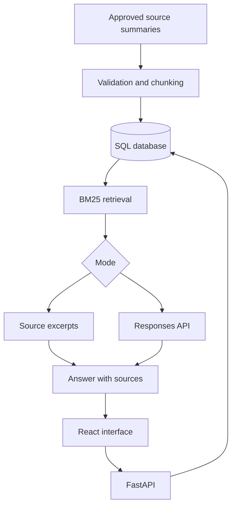

# CourtIQ 🏀

**Your build. Your questions. A coach that shows its work.**

A local NBA 2K27 MyCAREER research assistant with React, FastAPI, SQL storage, a repeatable document pipeline, BM25 retrieval, optional LLM answers, source citations and automated evaluation.

## Start on your Mac

Install **Python 3.11+** and **Node.js 22+** (24 recommended). Unzip the project and open its folder in VS Code. In the terminal:

```bash
bash start.sh
```

The launcher creates a virtual environment, installs dependencies, builds React, loads your root `.env` and starts **http://localhost:8000**. Stop with Ctrl+C. First launch requires an internet connection for dependencies. API docs: **http://localhost:8000/docs**.

Create a local account on the welcome screen. Your builds and history belong to that account.

It works without an API key in **demo mode**, which returns matching source summaries. Live mode generates answers from the retrieved sources.

### Docker alternative

With Docker Desktop running:

```bash
cp .env.example .env
docker compose up --build
```

Open **http://localhost:8000**. Compose uses PostgreSQL; the launcher uses SQLite. Stop with Ctrl+C then `docker compose down`. Data persists in a volume. `docker compose down -v` erases it.

## What's included

- **Accounts:** scrypt password hashes, revocable HTTP-only cookie sessions, ownership checks and an authentication attempt limit.
- **Coach:** grounded questions, inspectable citations, patch/source-date filter, latency and token usage.
- **My builds:** save, edit, delete and select player profiles.
- **Knowledge:** seven editorial summaries of official 2K announcements, source links and publication labels.
- **Conversation context:** recent user questions help interpret follow-ups, scoped to the selected build and source filter. Old generated answers are not treated as factual evidence.
- **Data pipeline:** validated JSON → normalized text → overlapping chunks → stable hashes → transactional SQL snapshot. Refreshes at startup and through a CLI.
- **Evaluation:** 30 fixed retrieval, expected-term and refusal checks, plus integration tests and an optional live evaluation runner.
- **Delivery:** multi-stage Docker image, Compose/PostgreSQL, GitHub Actions and this Mac launcher.

## Source accuracy

The included sources are brief summaries of **official 2K reports**, not placeholder practice notes. See [data/SOURCES.md](data/SOURCES.md) for provenance. Launch and Season 2 announcements are dated; they are **not full, current, platform-specific patch notes**.

This corpus supports questions about badge progression, loadouts, Synergy, the builder, Rhythm Shooting, defense, Takeover and Season 2. It does **not** provide individual badge attribute thresholds, upgrade prices or legal build-cap tables. CourtIQ explicitly refuses numerical eligibility questions rather than inventing requirements. The generic 25–99 attribute input range does not validate a legal in-game build.

A source filter matches its exact publication label. Launch labels are not assertions that a mechanic is unchanged in later versions. Default “all” can retrieve multiple publication periods; read the source labels.

## Enable generated LLM answers

Edit root `.env` (created by the launcher, or copy `.env.example`):

```dotenv
OPENAI_API_KEY=your-private-api-key
OPENAI_MODEL=your-accessible-responses-model-id
POSTGRES_PASSWORD=local-dev-only
```

Restart `bash start.sh`. For Docker, use `docker compose up -d --force-recreate app`.

Never commit `.env`. Keys remain server-side; they are not passed to React. API access is billed separately according to your provider/account. Set an API project spending limit before running large evaluations. See [OpenAI's official quickstart](https://developers.openai.com/api/docs/quickstart).

The backend sends relevant source passages and the selected player profile to the Responses API with `store=false`. It validates citation identifiers, displays usage, and reports provider errors explicitly. Citation syntax validation does not prove that the source supports a claim. Live calls were not run during delivery because no credentials were provided.

## Add or update knowledge

Add JSON files to `data/guides/`:

```json
{
  "source": "unique-source-id",
  "title": "Descriptive source title",
  "edition": "2K27",
  "patch": "verified-source-or-patch-label",
  "url": "https://your-permitted-source.example/guide",
  "sample": false,
  "text": "Your concise, checked factual summary. State any limitations."
}
```

Use content you have permission to use. Record edition, platform, source date and actual patch where relevant. `sample:false` identifies imported material; it does not certify truth. Empty URLs are allowed for local notes.

Restart the app, or run:

```bash
# From the project root with Docker:
docker compose exec app python -m app.pipeline

# Without Docker, from the project root:
cd backend
../.venv/bin/python -m app.pipeline
```

All JSON files are validated before the existing index is replaced. Chunks use 200-word windows with a 40-word overlap. Invalid files preserve the previous snapshot. Repeated imports do not duplicate chunks. Deleting a guide removes it on the next successful import. Run summaries are stored in SQL. No arbitrary remote URLs are fetched.

## Tests and evaluation

From the project root after running the launcher once:

```bash
cd backend
../.venv/bin/python -m pytest -q
../.venv/bin/python evaluate.py
```

The checked report is `evaluation/report.json`. Tests cover persistence, source citations, history, account isolation, session revocation, cross-origin write rejection, build-scoped follow-ups, patch separation, malformed imports, provider errors and invalid model citations.

For real model evaluation, set credentials in your terminal environment and run:

```bash
../.venv/bin/python -m dotenv -f ../.env run -- ../.venv/bin/python evaluate.py --live
```

This optional command makes paid API calls. It creates `evaluation/live-report.json` with responses, usage, automatic lexical checks and empty manual-review fields. Review factual correctness, citation support and patch consistency yourself. Expected-word checks are diagnostic, not proof of answer quality. No live evaluation score is claimed in the shipped report.

GitHub Actions runs backend tests, offline evaluation, the frontend build and Docker/PostgreSQL startup checks. CI is configured; execution in your GitHub repository is not claimed until you push it and inspect the run.

## Architecture



BM25 is lexical retrieval, not embeddings or a vector database. It is transparent and inexpensive for this small corpus; synonym matching is a limitation.

## Development

Backend hot reload:

```bash
source .venv/bin/activate
cd backend
python -m uvicorn app.main:app --env-file ../.env --reload
```

Separate terminal:

```bash
cd frontend
npm ci
npm run dev
```

Vite proxies `/api` to port 8000. Set `DATABASE_URL` to use another SQLAlchemy database connection. `.env` loads through the launcher or `--env-file`, not by simply importing the Python modules.

## Scope

This is a local portfolio application with accounts and per-user build/history isolation. The knowledge corpus is shared. Docker binds to localhost. Authentication throttling is in-memory per process; before public hosting, add shared rate limiting, HTTPS, managed secrets, backups and operational monitoring. Set `COOKIE_SECURE=true` under HTTPS, restrict `ALLOWED_ORIGINS`, and disable open registration when appropriate. Password reset, email verification and account recovery are not implemented. It is not hosted on AWS yet.

For upgrades from v1, back up your database. A small migration adds ownership columns; previous unowned builds/history are retained in SQL but are not exposed to new accounts. This prevents accidental transfer of old records. For a new demo, use a fresh database.

See [docs/VALIDATION.md](docs/VALIDATION.md) for what was actually tested and [docs/INTERVIEW_GUIDE.md](docs/INTERVIEW_GUIDE.md) for an explanation of the engineering choices.

Independent fan project; not affiliated with 2K or the NBA. No proprietary game artwork or logos are bundled.
